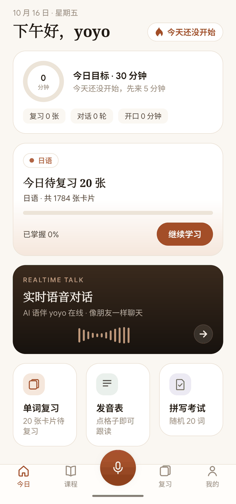
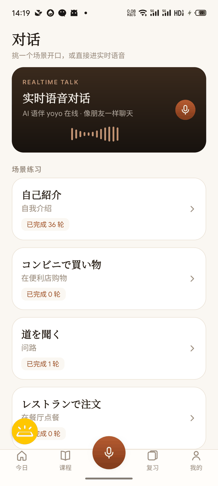
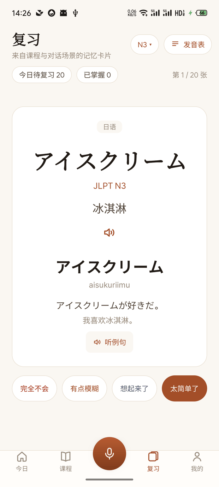
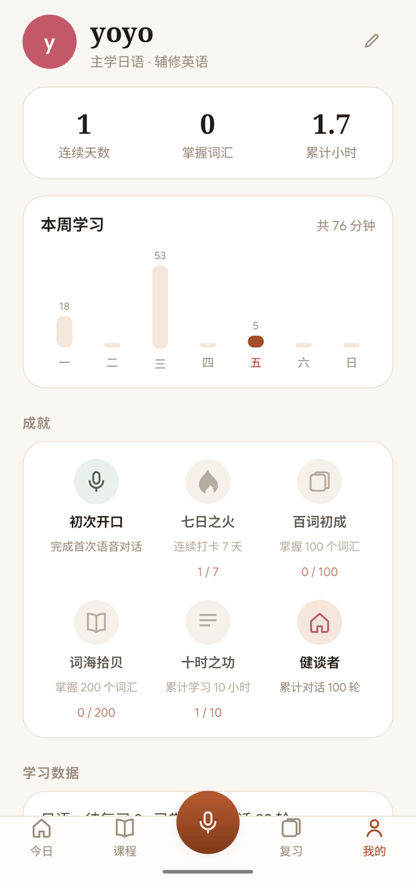

# 拾语（Shiyu）· 作品方案说明

> 一个「开口就能聊」的日语/英语口语陪练 App
> Android 原生 · 实时语音对话 · 场景练习 · 单词 SRS 复习
> 版本 v1.0.14（versionCode 15） | 2026-10

---

## 一、作品名称

**拾语（Shiyu）** —— 取名「拾起语言」，谐音「拾语」。

一款面向**中文母语者**的日语 / 英语口语陪练应用。解决的核心痛点是：
**想练口语，但没有人陪练、又不敢开口**。因此它把「开口说话」做成一个按钮 —— 点一下就能和 AI 语伴对话，说错了不会被嘲笑，说中文也不会卡住。

- 平台：Android（原生 Kotlin）
- 目标语言：日语、英语
- 形态：单机 App + 云端模型 API，安装即用（配置随包预置，无需用户填任何 Key）

---

## 二、界面预览

以下均为 2026-10 在真机（魅族 22）上的实际运行截图。










---

## 三、核心功能

### 1. 实时语音对话（主打）

点一次「开始说话」就开始收音，说完点「暂停说话」交给 AI 回应。整段交互是**双向 WebSocket 流式**，AI 的语音边说边播。

- **自动跟随语种**：不用先选语言。你说中文它用中文回，说英语用英语回，说日语用日语回 —— **同一场对话里换语种，它会跟着换**。
- **打字兜底**：不方便说话时可以打字，走同一个会话。
- **字幕与翻译**：AI 的话同步出字幕 + 中文小字；字幕可一键关闭（纯练听力）。
- **提示按钮**：卡壳时给一个**随机话题方向**（目标语言 + 中文），而不是干巴巴的「该说什么」。
- 会话结束后自动落盘，可在「历史对话」里回看、重命名、删除。

### 2. 场景对话练习

5 个高频生活场景 × 2 门语言，进入即由 AI 扮演角色（店员 / 面试官 / 路人……）：

| 日语 | 英语 |
|---|---|
| 自己紹介 / コンビニで買い物 / 道を聞く / レストランで注文 / 面接 | Self introduction / At the coffee shop / Asking for directions / Job interview / Making an appointment |

文字对话模式下 AI 按「**目标语言正文 + 中文翻译 + 纠错**」三段式回复，纠错单独成行，不混进正文。

### 3. 单词与题型训练

- **间隔重复（SM-2 算法）**：每张卡按记忆强度安排复习时间，只复习「快忘的」。
- **12 本词书 / 题库**（合计约 12 MB，全部离线内置）：日语 N5–N1、英语 CET4 / CET6 / 考研 / 雅思 / 托福 / GRE，另含五十音图与英语音标。
- **多种题型** + 每日配额，避免一次性刷太多。

### 4. 朗读与听力

每个词条、例句都能朗读，走云端 TTS，带**磁盘缓存 + 下一张卡预取**，翻卡时音频多数已就绪。

### 5. 学习数据

- 首页：连续天数、今日目标进度、待复习数量、对话轮数。
- 统计页：学习时长 / 完成量图表。
- 成就体系。
- 历史会话（含实时语音的整段对话）。

### 6. 多语言架构

日语、英语各自独立成模块（语言规则、音变、分词、场景、词书、语伴形象都按语言注入）。新增一门语言有独立交接文档，不必改动既有语言的代码。

---

## 四、技术方案与实现思路

### 4.1 技术栈

| 项 | 选型 |
|---|---|
| 语言 / 平台 | Kotlin，Android 原生（未用跨平台框架） |
| 构建 | Gradle 8.9 / AGP 8.7.3 / Kotlin 2.1.0 |
| SDK | minSdk 26 / targetSdk 35 |
| 网络 | OkHttp（HTTP + WebSocket 双向流） |
| 存储 | JSON 文件 + AtomicFile 原子写；API Key 走 Android Keystore 加密 |

### 4.2 分层设计（可测性优先）

```
core/    纯 JVM 逻辑：语言规则、协议编解码、算法、音频处理
         —— 由单测守门：禁止 import android.*（SourcePolicyTest 强制）
data/    持久化：设置、学习进度、会话记录、音频缓存
ai/      Provider 抽象层：chat / realtime / tts / asr 四组能力
ui/      页面与交互
```

**这样分层的收益**：绝大部分业务逻辑是纯函数，**可以脱离真机、在电脑上跑单测**——
这对一个「改一次要装一次包」的 Android 项目是决定性的效率差异。

### 4.3 能力抽象：按 host 自动择协议

四组能力（对话 / 实时语音 / 语音合成 / 语音识别）都是接口 + 多实现。
**协议按配置里 baseUrl 的 host 自动择一**，判断只此一处：

| 能力 | host 判据 | 协议 |
|---|---|---|
| 语音识别 | `*.volces.com` | 火山方舟（两步：上传 → 多模态对话） |
| 语音识别 | `*.stepfun.com` | StepFun 原生 SSE |
| 语音识别 | 其它 | Whisper 兼容 `/audio/transcriptions` |
| 实时语音 | `wss://…/v1/realtime` | 双向流式 |

好处：**换/加服务商只改配置，不动代码**；设置页还会按实际 host **动态显示**当前协议名，避免"界面写着 A、其实连的是 B"。

### 4.4 实时语音链路

```
麦克风 → 客户端 VAD 门控 → PCM16 分帧 → WebSocket 双向流
                                    ↓
                              服务端流式返回：音频 + 字幕 + 翻译
```

- **单键切换收音**（不用按住），关麦时推等长静音帧让服务端断句。
- 接入系统 **AEC（回声消除）+ 降噪**，避免 AI 的声音被自己听回去。
- 音频参数、VAD 阈值、静音时长都可在设置页调。

### 4.5 凭据安全

- API Key **不明文落盘**：Android Keystore 生成密钥，密文存储。
- 所有日志统一走脱敏器（`LogRedactor`），Key 只以掩码形式出现，**不会因日志泄漏**。

### 4.6 工程质量门槛

| 指标 | 当前值 |
|---|---|
| 单元测试 | **498 例 / 40 个测试类，0 失败**（纯 JVM，不依赖真机） |
| 静态检查 | **lint 0 error** |
| 主代码 | 93 个 Kotlin 文件 / 约 10,900 行 |
| 测试代码 | 38 个文件 / 约 5,100 行（测试代码 ≈ 主代码的 47%） |

**发版门槛是硬性的**：单测全绿 + lint 0 error 才允许出包；每次发版 versionCode 递增，APK 按版本号归档并异地备份一份。

---

## 五、作品创新点

### 创新点 1 · 实时语音「自动跟随语种」，靠发音判语言

常见做法是进页面前先选「练日语 / 练英语」，整场锁死一个语言。
本作品把它去掉了：**模型按用户这句话的实际发音判断该用什么语言回**，同一场对话里中→英→日切换都能跟上。

**关键实测发现**：模型判语种**只看音频，与转写文本无关** ——
实测有两句话的实时转写分别成了阿拉伯文乱码和**空字符串**，模型照样用正确的语言作答且内容接得上。
这个发现直接否掉了「先在客户端判语种再告诉模型」的方案，因为**两个可用的文本源都认不出语种**。

### 创新点 2 · 语音提示词的「防问卷化」设计

实时语音最初直接复用了场景练习的提示词，结果 AI 每次开口都问「你叫什么名字」——
因为提示词里写着「引导学习者说出目标表达」，而第一个场景的目标第一条就是 `My name is ...`。

修法不只是"写得更自然"，而是把**具体的坏行为点名禁止**：

> 严禁反复提问同一个问题。尤其不要每次都从「你叫什么名字」「你从哪里来」「你几岁」
> 这类自我介绍问题开始 —— **那是问卷，不是聊天**。

并配一条正向约束「话题跟着对方走，并且要经常换」，且给出具体话题方向。
**只写"要自然"是不够的**，实测必须同时给正例和反例。

### 创新点 3 · 发现并绕开 ASR 的语言硬伤

带中文口音的日语，被语音识别判成**中文**，输出中文谐音：
「おはようございます」→「哦，还有，给我唱野马写」。

**排查过程是数据驱动的**：
1. 用用户的**真实录音**做对照实验（不是公开样本 —— 公开样本是标准发音，复现不了"口音被判错语种"）；
2. 证明该服务商的 `language` / `prompt` / `hotwords` **三个参数都改不动输出文字体系**（6 种组合实测，输出始终是中文）；
3. 换一家能"用指令指定输出文字体系"的服务，**同一段录音一次就全对**；
4. 并解决了新服务的延迟问题：默认「深度思考」模式要 **137 秒**，关掉后降到 **1~2 秒**。

这条路的结论：**语音识别不是加个参数就能修的，得换模型类别。**

### 创新点 4 · 配置随包预置 + 按语言覆盖

用户装完不用填任何 Key。预置配置支持**按语言覆盖**（`langGroups.<语言>.<组>`），
所以能做到「**只有日语**的语音识别走某条通路，英语完全不受影响」。

这里踩过一个坑并留下机制：预置的版本号如果全局递增，会**连带强制覆盖所有组**，
把用户自己调过的设置（例如音色）一起冲掉。因此拆出了**独立的按语言版本号**，
让"只推这一项"成为可能 —— 改动范围可精确控制。

### 创新点 5 · 工程方法论：日志即判据

每个易出问题的环节都留了**可观测指标**，而不是"感觉好了"：

- 实时语音：字幕用「原文 vs 纠错」并排打印，一眼看出是识别错还是链路没跑；
- TTS：`HIT / MISS / WAIT / FAIL` + 耗时，判断缓存命中与延迟瓶颈；
- 会话：建立、`session.update` 内容、关闭码（`code=1000` 为正常）。

排障时**先取证、再下结论**，宁可多跑一次验证，也不给"听起来合理"的猜测。

---

## 六、Step 模型使用情况

本项目共使用 **4 类 Step 模型**，覆盖「对话 / 实时语音 / 语音合成 / 语音识别」四个环节：

| 环节 | 模型 | 接入方式 | 说明 |
|---|---|---|---|
| 文字对话 | `step-5-preview` | `POST /chat/completions` | 场景对话、翻译、纠错、例句讲解 |
| 实时语音 | `stepaudio-3-realtime-preview` | `WSS /v1/realtime` 双向流式 | 语音进、语音出 + 同步字幕 |
| 语音合成 | `stepaudio-2.5-tts` | `POST /audio/speech` | 单词、例句、长文朗读 |
| 语音识别 | `stepaudio-2.5-asr` | `POST /audio/asr/sse` | 录音转文字 |

### 6.1 用 Step 模型做的工程优化

**① 语音合成：磁盘缓存 + 预取**
朗读延迟从「每次现合成」改为「命中即播」。日志按 `HIT / MISS / WAIT / FAIL` 分类并记耗时，
缓存命中时几乎瞬时；未命中时并行预取**下一张卡**的音频，翻卡基本不等。

**② 实时语音：把"规则"从提示词搬到客户端**
轻量实时语音模型对长规则列表**遵循度有限**。实测「用户要求说中文就照做」这条规则，
换了两版措辞都压不住。于是改成：**客户端识别意图 → 重发 `session.update` 直接改系统提示**，
模型看到的不是"可选规则"而是"现在就用中文"，问题即解。

**③ 实时语音：字幕与音频解耦**
实时通道的字幕在非中英语种上不可靠（日语会被按中英解码成中文谐音）。
最终方案是**字幕忠实于实时通道输出**，同时确认**模型本身听得懂**（回复内容正确）——
即把"能听懂"和"字幕是否好看"两件事分开对待，不为字幕牺牲功能范围。

**④ 语音识别：正确地承认边界并换方案**
如上文创新点 3：带口音日语在 `stepaudio-2.5-asr` 上无法通过参数修正，
最终**按语言分流** —— 日语走另一家能"指定输出文字体系"的服务，中英仍走原通路。
这是一次**有实测支撑的能力边界判断**，而不是调参调不出来就放弃。

### 6.2 遇到的典型问题与解法

| 问题 | 根因 | 解法 |
|---|---|---|
| 语音模式下 AI 会念出「JA」「ZH」 | 复用了文字对话的三段式提示词，语音会照念标签 | 语音单独一份提示词，且不含任何格式标记 |
| 日语字幕显示中文谐音 | 该 ASR 按中英解码日语，`language` 等参数无效 | 日语按语言切到另一条通路 |
| 新通路延迟 137 秒 | 模型默认开启深度思考 | 关思考 + 指定输出文字体系 → 1~2 秒 |
| AI 反复问名字 | 提示词引导"说出目标表达" + 场景固定为自我介绍 | 改自由聊天，并点名禁止该类提问 |
| 中文回答在气泡里印两遍 | 无条件追加"翻译成中文" | 原文已是中文则跳过翻译，省一次调用 |

---

## 七、小结

拾语是一个**把「敢开口」当成第一性问题**来做的语言陪练 App：

- 交互上，把口语练习压缩成"按一下就开始说"，并用**自动跟随语种**去掉所有前置选择；
- 工程上，用**分层 + 纯 JVM 单测（498 例）**把真机依赖降到最低，让迭代速度可控；
- 模型使用上，不把大模型当黑盒 —— 四个环节各选合适的 Step 模型，
  并用**真实数据**定位边界（口音、语种、延迟），该优化的优化、该换路的换路。

---

*文档随工程同步维护：`HANDOVER-拾语App.md`（完整技术交接）、`TASK-实时语音自动语种切换.md`（最近一项改造的完整调查与实测记录）。*
